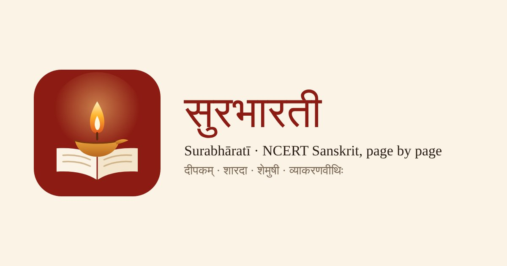

# सुरभारती · Surabhāratī



**NCERT Sanskrit, page by page** — the NCERT Sanskrit textbooks for Classes 6–10 and the Class 9–10 grammar book as a reading and self-study web app: दीपकम् (कक्षा 6–8), शारदा (कक्षा 9), शेमुषी (कक्षा 10) and व्याकरणवीथिः.

*सुरभारती*, "the speech of the gods", is a classical name for Sanskrit. The logo is a lit दीप on an open book.

**Live site:** https://rampsuthar1999-arch.github.io/ncert-sanskrit/

A static web app for the NCERT Class 6 Sanskrit textbook **दीपकम्**. Every page is shown exactly as printed (same images, same layout). On top of the pages sits an invisible, tappable study layer for adult self-learners.

## Books
- **Class 6** – site root (`/`): full study layer for chapters 1–8, word-meaning review cards for 9–16.
- **Class 7** – `class7/`: word-meaning tables of chapters 1–12 and the अतिरिक्तम् अध्ययनम् section as review cards, plus a box beside each row to write the meaning in your own language. Highlights, notes, page flashcards and search work on every page.
- **Class 8** – `class8/`: word-meaning tables of chapters 1–13 as review cards with a मातृभाषया box per row (the phonetics terminology chart in chapter 13 is not included).
- **Class 9 (शारदा)** – `class9/`: the सर्वं शब्देन भासते tables of chapters 1–11 as review cards, each word with its grammar note, plus a मातृभाषया box per row.
- **Class 10 (शेमुषी)** – `class10/`: the शब्दार्थाः lists of chapters 1–10 as review cards. The PDFs use a legacy (Chanakya) font; their text was converted to Unicode so search works. The book has no blank column for your own meaning, so this class has no on-page boxes.
- **व्याकरणम् (व्याकरणवीथिः, Classes 9–10)** – `vyakarana/`: the NCERT Sanskrit grammar book (वर्ण, सन्धि, शब्दरूप, धातुरूप, उपसर्ग, अव्यय, प्रत्यय, समास, कारक, वाच्य, रचना, and the full शब्दरूप/धातुरूप appendices) with search, highlights, notes, page flashcards and the paradigm-table view.
- A *Books* row on each home page switches between classes. Each book keeps its own progress and cards.

## Reading
- Cover + पाठानुक्रमणिका as chapter cards, with reading progress per chapter
- Two-page spread on desktop, single page on phones; swipe / arrow keys to turn pages
- Jump to any printed page (`25`, `iii`), shareable links (`#/page/98`), thumbnails, zoom, full screen
- Whole-book search in Devanagari or Roman typing (`vRkShaaH`)
- Works offline after pages are viewed; installable as an app

## Study layer (chapters 1–8 fully prepared; chapters 9–16: word-meaning tables as review cards; tools work on every page)
| Feature | Where |
|---|---|
| **Tap any word** → base form, gender/case/number or tense/person, sandhi split, Hindi + English meaning, link to its full declension/conjugation table | Chapter 4 pages |
| **Translations revealed one sentence at a time** (Hindi, English, short grammar note) | Study panel (book icon / `P`) → Sentences |
| **Listen** (device Sanskrit/Hindi voice, adjustable speed, word-by-word highlighting on the page) and **record yourself**, then compare | Word popup, Study panel |
| **Exercises on the page**: answer boxes sit on the printed blanks; check, see explanations, reveal answers. Type in Devanagari or Roman (`aavaaM` → आवां) | Pages 52–60, Study panel → Exercises |
| **Spaced-repetition review**: the book's word-meaning tables are added automatically; save any word ★, sentence ★, or any part of a page as a card. Each card shows the slice of the page it came from | Home → Review (`#/review`) |
| **Grammar tables that grow as you read** (29 paradigms: nouns, pronouns, verbs) with the tapped form highlighted | `#/grammar` |
| **Highlights & notes** anywhere in the book; notebook view with export to Markdown | ✎ tool (`M`), `#/notes` |
| **Progress**: due cards, streak, recall rate, chapters read, weak areas from your mistakes; settings and backup/restore | `#/progress` |

All study data is stored in the browser (localStorage + IndexedDB for recordings). Use **Progress → Settings → Export backup** to keep a copy or move to another device.

## Publish on GitHub Pages
1. Create a new repository on GitHub (e.g. `deepakam`).
2. Upload **all files and folders in this folder** to the repository root.
3. **Settings → Pages** → *Deploy from a branch* → `main` / `(root)` → Save.
4. The site goes live at `https://<your-username>.github.io/deepakam/`.

```bash
cd deepakam
git init && git add . && git commit -m "Deepakam reader"
git branch -M main
git remote add origin https://github.com/<your-username>/deepakam.git
git push -u origin main
```

## Structure
- `index.html`, `css/style.css` – layout
- `js/app.js` – reader (pages, navigation, search, routing)
- `js/study.js` – study layer (popups, panel, exercises, review, grammar, notes, progress)
- `js/translit.js` – Roman → Devanagari typing, Devanagari → IAST
- `book.json`, `search.json` – chapters, pages, page text for search
- `study/ch04.json` – chapter 4: word analyses, sentence translations, exercise answer keys, all positioned on the page
- `study/grammar.json` – declension and conjugation tables
- `pages/`, `thumbs/` – page images
- `sw.js`, `manifest.webmanifest` – offline / install

### Adding another class
Copy the `class7/` folder (e.g. to `class8/`), replace `pages/`, `thumbs/`, `book.json`, `search.json` and `study/`, and edit the `window.BOOK` line in its `index.html` (`name`, `ih` = page-image height, `cls`, `pfx`, `toc`, `study`, `shelf`). Add the new class to `shelf` in every book's `index.html`.

### Adding another chapter
Create `study/chNN.json` in the same format as `ch04.json` and add it to `STUDY` at the top of `js/study.js`.

Content © NCERT. Original PDFs: https://ncert.nic.in/textbook.php?fsde1=0-16
